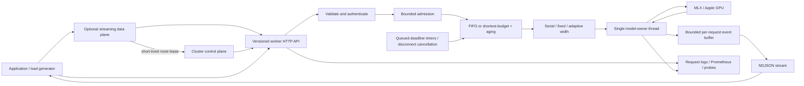

# Inference service architecture

## Cluster control plane

`control_plane.py` owns cluster decisions without owning a model. Its integrated
generation endpoint remains available for compatibility and v0.8.3 comparison.
`data_plane.py` can instead obtain a short-lived route lease and proxy the worker
NDJSON stream on a separate event loop. It owns downstream backpressure and
cancellation, completes reservations in a shielded `finally` path and never
forwards the control credential to workers. Expired leases prevent capacity from
remaining reserved after a gateway crash.
`routing.py` owns the worker registry, health state, drain state, reservations and
bounded audit history. `cluster.py` starts one restart supervisor per worker, waits
for readiness and then starts the control plane. Each worker still has a single
model-owner thread and its own admission boundary.

Capacity-aware placement excludes stale, unhealthy, draining, incompatible and
full workers. It sorts eligible workers by load ratio, estimated reservation
pressure, assignment count and worker ID. A reservation is created before proxy
dispatch and released in a `finally` block. Model and artifact constraints are
placement inputs and are not forwarded to the worker generation endpoint.

The control plane never retries a request after dispatch because the worker may
have generated tokens before the connection failed. A mid-stream worker loss
therefore emits one terminal `worker_transport_error` event containing the chosen
placement and original worker request ID. A caller can choose to retry, but the
service cannot promise exactly-once inference without durable request identity and
worker-side deduplication.

## Ownership and concurrency

`server.py` owns transport, validation, authentication and response delivery.
`engine.py` owns request lifecycle and the sole model execution thread.
`scheduler.py` owns bounded waiting capacity and next-job selection. `backend.py`
is the MLX adapter and closes its underlying generator explicitly.
`batch_engine.py` owns fixed/adaptive sequence execution and `adaptive.py` makes
bounded, explainable width decisions without preempting active sequences.

All model loading, warmup, tokenization, inference, generator advancement,
cleanup and allocator inspection run on the model thread. The asyncio loop
continues to serve health/metrics, reject overload and expire waiting jobs while
that thread executes a GPU operation. HTTP concurrency is not GPU parallelism.

## Request lifecycle

1. Validate authentication and the bounded JSON body.
2. Validate prompt bytes, output budget and deadline. Token-length validation is
   deferred to the model thread; it can produce a streaming error.
3. Admit without waiting. If no queue slot exists, return structured HTTP 503.
4. Schedule FIFO or shortest-budget, with the oldest-job aging override.
5. Advance the model generator serially, count token IDs and record monotonic
   timestamps. Bounded stream buffers provide backpressure.
6. Close the model generator before publishing a successful terminal event.
7. Count exactly one worker outcome. Delivery success remains a client metric.

Waiting jobs have independent deadline tasks and can be removed on disconnect.
Active jobs stop between model steps. Scheduler joins account for both active
jobs and discarded waiting jobs; no synthetic queue "completion" is counted as
successful inference.

## Failure boundaries

Invalid prompts and per-request inference exceptions produce safe error events.
Internal exception messages, prompts and credentials are not logged. Backend
cleanup failure marks readiness unhealthy and fails pending jobs, since sharing
an uncertain model/cache state with later work is unsafe. A stopped worker also
fails pending clients. Restoring an unhealthy backend currently requires restart.

Shutdown first stops admission, fails queued jobs and requests active cancellation;
then it drains HTTP handlers. Repeated shutdown calls share one close task. The
in-process worker cannot forcibly interrupt a GPU call.

## Measurement and provenance

Server timings use admission as zero. Queue wait ends at dispatch; TTFT includes
queueing, tokenization and prefill. Client timings include transport/buffering.
Output-token counters exclude EOS. Batch phase timing is synchronized around
`BatchGenerator.next()` and labels empty-response steps as prefill. It is not
kernel attribution; `kernel_capture.py` creates an opt-in Metal trace for that.

`artifacts.py` resolves model snapshots and hashes model/config/tokenizer contents.
`environment.py` fingerprints package source and records runtime dependencies.
`workloads.py` constructs seeded plans with content fingerprints. `experiment.py`
owns repeated server processes, warmup, raw results and source snapshots.
`compare.py` checks comparability before aggregating per-run metrics by class.

Full-workload throughput includes pacing and failures. Percentiles are calculated
on successful requests, so error/rejection rates must always accompany them.
Per-class throughput divides that class's completed tokens by the same whole-run
wall time; it is not an independent estimate of the class's serving capacity.

## Why start with serial execution?

Serial execution provides a comprehensible baseline and avoids concurrent access
to mutable model/tokenizer state. It exposes queueing and fairness effects
directly. Its limitation is capacity: more client concurrency alone cannot make
the model decode multiple sequences simultaneously. True batching requires a
separate execution design, per-sequence cache lifecycle and additional correctness
tests rather than simply adding worker threads.

## v1.0 CUDA batching and quantization

See [docs/v10-architecture.md](docs/v10-architecture.md): a batched forward pass over a fixed KV slot pool behind the existing adapter interface, explicit NF4
quantization, and the observability added for the GPU evaluation. Implemented and tested on CPU and in the Linux image; not yet run on a GPU.
